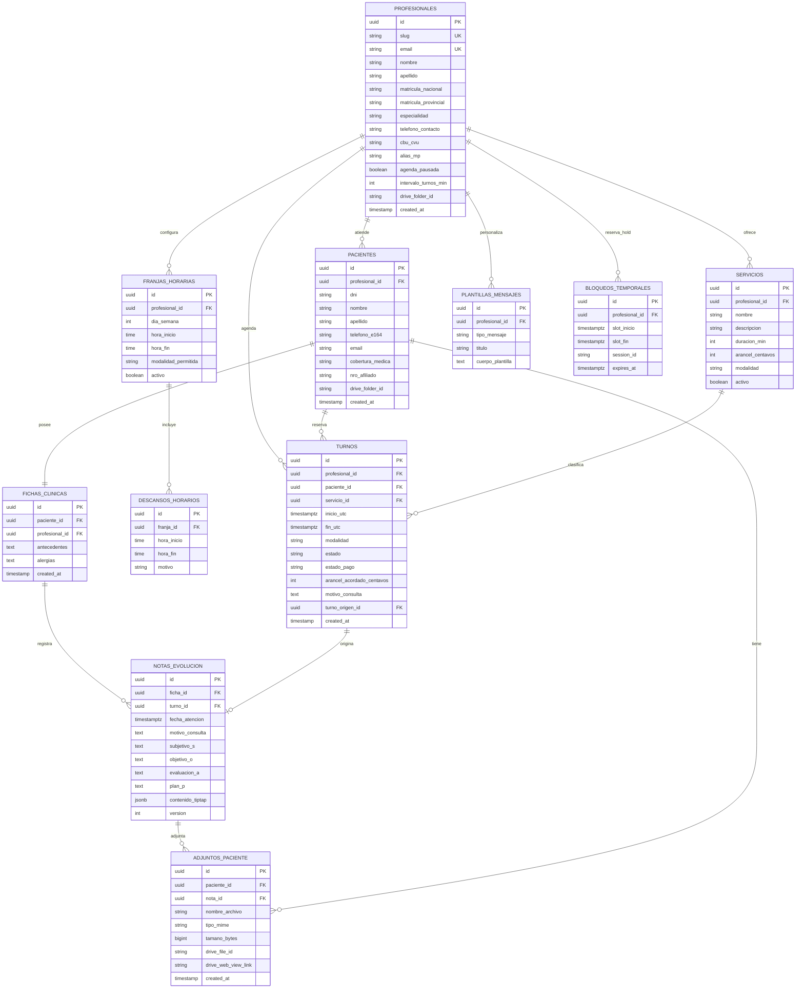

# MediTurnos — Plan de Arquitectura: Google Drive Database & Modelo Relacional PostgreSQL

Plan integral para dotar a MediTurnos de:
1. **Identificación del Profesional con Google & Base de Datos Estructurada en Google Drive**: Sesión con cuenta de Google (OAuth `drive.file`), creación y mantenimiento de una **carpeta maestra** en el Google Drive del profesional que funciona como base de datos organizada (tablas en formato JSON atómico para configuraciones, turnos e historias clínicas de pacientes con subcarpetas de adjuntos médicos).
2. **Modelo Relacional Estándar PostgreSQL**: Diseño formal de base de datos relacional con DDL SQL exportable para **MySQL Workbench**, **pgAdmin** y **DBeaver**, acompañado del diagrama Entidad-Relación interactivo en **Mermaid**.

---

## User Review & Critical Decisions

> [!IMPORTANT]
> **Decisiones confirmadas en la Fase 1:**
>
> 1. **Formato en Google Drive**: Archivos **JSON estructurados y atómicos** (`.json`), garantizando máxima velocidad, serialización directa de tipos TypeScript, respaldo sin pérdida de atributos y operaciones seguras.
> 2. **Formato de Modelado Relacional**: **DDL SQL ANSI/PostgreSQL completo y estricto**, formateado con sintaxis compatible con la función de *Reverse Engineering* (ingeniería inversa) de **MySQL Workbench**, **pgAdmin 4** y **DBeaver**, complementado con un diagrama interactivo **Mermaid ERD**.
> 3. **Estrategia de Sincronización**: Enfoque **Local-First con sincronización asíncrona en segundo plano**. La aplicación responde de inmediato desde IndexedDB/LocalStorage del navegador y despacha cambios a Google Drive sin bloquear la UI ni depender de latencias de red.
> 4. **Alcance de Permisos Google (OAuth)**: Uso del alcance mínimo privilegiado `https://www.googleapis.com/auth/drive.file`. Esto autoriza a la app a interactuar exclusivamente con la carpeta y archivos creados por MediTurnos, protegiendo 100% la privacidad del resto de los documentos personales del médico.

---

## 1. Overview & Core Concept

### Qué resuelve este enfoque
- **Soberanía y privacidad de datos del profesional**: Los datos de los pacientes y los archivos adjuntos (radiografías, análisis, estudios) se guardan directamente en el Google Drive privado del profesional. No hay servidores de bases de datos compartidos de terceros leyendo información sensible de salud.
- **Cero costo de infraestructura**: El profesional utiliza el almacenamiento gratuito de su cuenta de Google (15 GB) para almacenar fichas, notas y estudios médicos sin necesidad de pagar servidores dedicados.
- **Resiliencia Local-First**: En el consultorio, el profesional puede seguir anotando y gestionando turnos aun si se cae la conexión a internet. Al restablecerse la red, la cola de sincronización actualiza los archivos JSON en Google Drive.
- **Portabilidad Corporativa y Escalabilidad**: El diseño relacional en PostgreSQL define el estándar formal de datos de la industria médica, permitiendo en cualquier momento exportar o migrar el sistema hacia una nube relacional (Cloud SQL, Supabase, Neon).

---

## 2. User Experience & Visual Design

### A. Flujo de Vinculación y Gestión de Google Drive en el Dashboard
1. **Botón 'Conectar con Google Drive'**:
   - Ubicado en el Modal de Perfil/Configuración.
   - Botón oficial con estética Google y estado visible: `No conectado` (almacenamiento local temporal) ➔ `Conectando...` ➔ `Conectado como doctor@gmail.com`.
2. **Acreditación y Creación Automática de la Carpeta Maestra**:
   - Al autenticar con popup de Google, la app verifica si existe la carpeta `MediTurnos_Data` en la raíz de su Google Drive.
   - Si no existe, la crea instantáneamente junto con las subcarpetas de estructura base.
3. **Indicador de Sincronización en Segundo Plano**:
   - En la barra superior: ícono de nube con tres estados claros:
     - `Sincronizado`: Todo al día con Google Drive.
     - `Sincronizando (3 cambios)`: Cola de escritura activa con indicador giratorio sutil.
     - `Sin conexión / Pendiente`: Cambios guardados localmente, esperando reconexión.
4. **Ficha del Paciente con Adjuntos en Google Drive**:
   - Dentro de cada paciente, la sección de **Adjuntos Clínicos** permite arrastrar archivos (PDF, JPG, PNG).
   - Se suben de manera multipart a Google Drive dentro de `pacientes/paciente_{DNI}_{Apellido}/adjuntos/`.
   - Se muestra previsualización rápida y enlace seguro para abrir el documento en Google Drive.

---

## 3. Key Product Decisions & Trade-Offs

| Decisión | Enfoque Elegido | Razón / Ventaja | Alternativa Descartada |
| :--- | :--- | :--- | :--- |
| **Almacenamiento en Drive** | Archivos JSON por dominio (`_configuracion/`, `_turnos/`, carpetas individuales por paciente) | Operaciones atómicas, deserialización rápida, evita problemas de concurrencia y límites de celdas en hojas de cálculo. | Archivo monolítico gigante (riesgo de corrupción) o Sheets (lento para datos jerárquicos). |
| **Separación de Pacientes** | Una carpeta por paciente `paciente_{DNI}_{Apellido}/` | Excelente orden visual en Google Drive; el médico puede buscar al paciente directamente en su buscador de Drive. | Todos los archivos sueltos en una sola carpeta (desorden inmanejable). |
| **Seguridad de Acceso** | OAuth Scope `drive.file` | Privilegio mínimo: la app no puede ver fotos, documentos personales ni emails del profesional. | `drive` completo (demasiado invasivo e innecesario). |
| **Dualidad Arquitectural** | JSON en Drive para producción serverless + DDL PostgreSQL formal | Flexibilidad total: funciona sin backend costoso hoy, y está 100% normalizado para migrar a PostgreSQL mañana. | Esquemas no estructurados sin validación de integridad. |

---

## 4. Technical Architecture & Data Strategy

### A. Estructura Jerárquica de la 'Carpeta Maestra' en Google Drive

```
📁 MediTurnos_Data/                               (Carpeta Maestra en Google Drive)
├── 📁 _configuracion/
│   ├── profesional.json                          (Perfil, matrículas, alias CBU, preferencias)
│   ├── servicios.json                            (Catálogo de prestaciones, precios en ARS, duraciones)
│   ├── horarios_atencion.json                    (Días, franjas horarias, descansos y modalidades)
│   └── plantillas_mensajes.json                  (Templates WhatsApp con variables)
│
├── 📁 _turnos/
│   ├── turnos_activos.json                       (Agenda en curso, turnos pendientes y confirmados)
│   └── turnos_historicos.json                    (Registro histórico auditable de consultas pasadas)
│
└── 📁 pacientes/
    ├── 📁 paciente_35123456_Perez_Juan/
    │   ├── ficha_clinica.json                    (Filiación, cobertura, notas SOAP, diagnósticos)
    │   └── 📁 adjuntos/
    │       ├── 2026-10-15_analisis_sangre.pdf    (Archivo original cargado)
    │       └── 2026-10-18_resonancia_lumbar.jpg  (Imagen médica)
    │
    └── 📁 paciente_28987654_Gomez_Maria/
        ├── ficha_clinica.json
        └── 📁 adjuntos/
```

---

### B. Diagrama Entidad-Relación (Mermaid ERD)



---

### C. Script DDL SQL Completo (PostgreSQL / MySQL Workbench / pgAdmin)

```sql
-- ============================================================================
-- MEDITURNOS — ESQUEMA RELACIONAL CANÓNICO (POSTGRESQL & ANSI SQL)
-- Compatible con: pgAdmin 4, MySQL Workbench (Reverse Engineering), DBeaver
-- ============================================================================

-- 1. Habilitar extensión UUID
CREATE EXTENSION IF NOT EXISTS "uuid-ossp";

-- 2. Tipos Enumerados (Enums)
DO $$ BEGIN
    CREATE TYPE modalidad_atencion AS ENUM ('presencial', 'videollamada', 'ambas');
EXCEPTION
    WHEN duplicate_object THEN null;
END $$;

DO $$ BEGIN
    CREATE TYPE estado_turno AS ENUM ('pendiente', 'atendido', 'ausente', 'cancelado', 'reprogramado');
EXCEPTION
    WHEN duplicate_object THEN null;
END $$;

DO $$ BEGIN
    CREATE TYPE estado_pago AS ENUM ('pendiente', 'pagado', 'exento');
EXCEPTION
    WHEN duplicate_object THEN null;
END $$;

DO $$ BEGIN
    CREATE TYPE canal_mensaje AS ENUM ('whatsapp', 'email', 'sms');
EXCEPTION
    WHEN duplicate_object THEN null;
END $$;

-- 3. Tabla: profesionales
CREATE TABLE IF NOT EXISTS profesionales (
    id UUID PRIMARY KEY DEFAULT uuid_generate_v4(),
    slug VARCHAR(100) NOT NULL UNIQUE,
    email VARCHAR(255) NOT NULL UNIQUE,
    nombre VARCHAR(100) NOT NULL,
    apellido VARCHAR(100) NOT NULL,
    titulo VARCHAR(100) NOT NULL DEFAULT 'Licenciado en Kinesiología',
    especialidad VARCHAR(100) NOT NULL DEFAULT 'Kinesiología y Fisiatría',
    matricula_nacional VARCHAR(50),
    matricula_provincial VARCHAR(50),
    telefono_contacto VARCHAR(50),
    cbu_cvu VARCHAR(22),
    alias_mp VARCHAR(50),
    titular_cuenta VARCHAR(150),
    agenda_pausada BOOLEAN NOT NULL DEFAULT FALSE,
    intervalo_turnos_min INT NOT NULL DEFAULT 30 CHECK (intervalo_turnos_min > 0),
    anticipacion_minima_hs INT NOT NULL DEFAULT 2 CHECK (anticipacion_minima_hs >= 0),
    horizonte_maximo_dias INT NOT NULL DEFAULT 30 CHECK (horizonte_maximo_dias > 0),
    margen_entre_turnos_min INT NOT NULL DEFAULT 0 CHECK (margen_entre_turnos_min >= 0),
    drive_folder_id VARCHAR(255),
    drive_folder_url TEXT,
    created_at TIMESTAMPTZ NOT NULL DEFAULT CURRENT_TIMESTAMP,
    updated_at TIMESTAMPTZ NOT NULL DEFAULT CURRENT_TIMESTAMP
);

-- 4. Tabla: servicios
CREATE TABLE IF NOT EXISTS servicios (
    id UUID PRIMARY KEY DEFAULT uuid_generate_v4(),
    profesional_id UUID NOT NULL REFERENCES profesionales(id) ON DELETE CASCADE,
    nombre VARCHAR(150) NOT NULL,
    descripcion TEXT,
    duracion_min INT NOT NULL DEFAULT 30 CHECK (duracion_min > 0),
    arancel_centavos BIGINT NOT NULL DEFAULT 0 CHECK (arancel_centavos >= 0),
    moneda VARCHAR(3) NOT NULL DEFAULT 'ARS',
    modalidad modalidad_atencion NOT NULL DEFAULT 'ambas',
    activo BOOLEAN NOT NULL DEFAULT TRUE,
    orden INT NOT NULL DEFAULT 0,
    created_at TIMESTAMPTZ NOT NULL DEFAULT CURRENT_TIMESTAMP,
    updated_at TIMESTAMPTZ NOT NULL DEFAULT CURRENT_TIMESTAMP
);

CREATE INDEX IF NOT EXISTS idx_servicios_profesional ON servicios(profesional_id, activo);

-- 5. Tabla: franjas_horarias (Disponibilidad semanal recurrente)
CREATE TABLE IF NOT EXISTS franjas_horarias (
    id UUID PRIMARY KEY DEFAULT uuid_generate_v4(),
    profesional_id UUID NOT NULL REFERENCES profesionales(id) ON DELETE CASCADE,
    dia_semana SMALLINT NOT NULL CHECK (dia_semana BETWEEN 1 AND 7), -- 1: Lunes, 7: Domingo
    hora_inicio TIME NOT NULL,
    hora_fin TIME NOT NULL,
    modalidad_permitida modalidad_atencion NOT NULL DEFAULT 'ambas',
    activo BOOLEAN NOT NULL DEFAULT TRUE,
    created_at TIMESTAMPTZ NOT NULL DEFAULT CURRENT_TIMESTAMP,
    CONSTRAINT check_orden_horas CHECK (hora_inicio < hora_fin)
);

CREATE INDEX IF NOT EXISTS idx_franjas_profesional_dia ON franjas_horarias(profesional_id, dia_semana, activo);

-- 6. Tabla: descansos_horarios
CREATE TABLE IF NOT EXISTS descansos_horarios (
    id UUID PRIMARY KEY DEFAULT uuid_generate_v4(),
    franja_id UUID NOT NULL REFERENCES franjas_horarias(id) ON DELETE CASCADE,
    hora_inicio TIME NOT NULL,
    hora_fin TIME NOT NULL,
    motivo VARCHAR(100) DEFAULT 'Almuerzo / Descanso',
    CONSTRAINT check_orden_descanso CHECK (hora_inicio < hora_fin)
);

-- 7. Tabla: pacientes (Padrón por profesional)
CREATE TABLE IF NOT EXISTS pacientes (
    id UUID PRIMARY KEY DEFAULT uuid_generate_v4(),
    profesional_id UUID NOT NULL REFERENCES profesionales(id) ON DELETE CASCADE,
    dni VARCHAR(20) NOT NULL,
    nombre VARCHAR(100) NOT NULL,
    apellido VARCHAR(100) NOT NULL,
    telefono_e164 VARCHAR(30) NOT NULL,
    email VARCHAR(255),
    cobertura_medica VARCHAR(100) NOT NULL DEFAULT 'Particular',
    nro_afiliado VARCHAR(50),
    drive_folder_id VARCHAR(255),
    created_at TIMESTAMPTZ NOT NULL DEFAULT CURRENT_TIMESTAMP,
    updated_at TIMESTAMPTZ NOT NULL DEFAULT CURRENT_TIMESTAMP,
    CONSTRAINT uq_profesional_paciente_dni UNIQUE (profesional_id, dni)
);

CREATE INDEX IF NOT EXISTS idx_pacientes_dni ON pacientes(dni);
CREATE INDEX IF NOT EXISTS idx_pacientes_profesional ON pacientes(profesional_id, apellido, nombre);

-- 8. Tabla: turnos
CREATE TABLE IF NOT EXISTS turnos (
    id UUID PRIMARY KEY DEFAULT uuid_generate_v4(),
    profesional_id UUID NOT NULL REFERENCES profesionales(id) ON DELETE CASCADE,
    paciente_id UUID NOT NULL REFERENCES pacientes(id) ON DELETE RESTRICT,
    servicio_id UUID NOT NULL REFERENCES servicios(id) ON DELETE RESTRICT,
    inicio_utc TIMESTAMPTZ NOT NULL,
    fin_utc TIMESTAMPTZ NOT NULL,
    modalidad modalidad_atencion NOT NULL DEFAULT 'presencial',
    estado estado_turno NOT NULL DEFAULT 'pendiente',
    estado_pago estado_pago NOT NULL DEFAULT 'pendiente',
    arancel_acordado_centavos BIGINT NOT NULL DEFAULT 0,
    motivo_consulta TEXT,
    notas_administrativas TEXT,
    turno_origen_id UUID REFERENCES turnos(id) ON DELETE SET NULL, -- Para reprogramaciones
    created_at TIMESTAMPTZ NOT NULL DEFAULT CURRENT_TIMESTAMP,
    updated_at TIMESTAMPTZ NOT NULL DEFAULT CURRENT_TIMESTAMP,
    CONSTRAINT check_rango_horario CHECK (inicio_utc < fin_utc)
);

CREATE INDEX IF NOT EXISTS idx_turnos_profesional_fecha ON turnos(profesional_id, inicio_utc, estado);
CREATE INDEX IF NOT EXISTS idx_turnos_paciente ON turnos(paciente_id);

-- 9. Tabla: bloqueos_temporales (Hold de 10 minutos para evitar doble reserva en portal)
CREATE TABLE IF NOT EXISTS bloqueos_temporales (
    id UUID PRIMARY KEY DEFAULT uuid_generate_v4(),
    profesional_id UUID NOT NULL REFERENCES profesionales(id) ON DELETE CASCADE,
    slot_inicio TIMESTAMPTZ NOT NULL,
    slot_fin TIMESTAMPTZ NOT NULL,
    session_id VARCHAR(100) NOT NULL,
    expires_at TIMESTAMPTZ NOT NULL,
    created_at TIMESTAMPTZ NOT NULL DEFAULT CURRENT_TIMESTAMP,
    CONSTRAINT check_hold_rango CHECK (slot_inicio < slot_fin)
);

CREATE INDEX IF NOT EXISTS idx_bloqueos_expiracion ON bloqueos_temporales(profesional_id, expires_at);

-- 10. Tabla: fichas_clinicas
CREATE TABLE IF NOT EXISTS fichas_clinicas (
    id UUID PRIMARY KEY DEFAULT uuid_generate_v4(),
    paciente_id UUID NOT NULL UNIQUE REFERENCES pacientes(id) ON DELETE CASCADE,
    profesional_id UUID NOT NULL REFERENCES profesionales(id) ON DELETE CASCADE,
    antecedentes_personales TEXT,
    antecedentes_patologicos TEXT,
    alergias TEXT,
    medicacion_habitual TEXT,
    drive_file_id VARCHAR(255),
    created_at TIMESTAMPTZ NOT NULL DEFAULT CURRENT_TIMESTAMP,
    updated_at TIMESTAMPTZ NOT NULL DEFAULT CURRENT_TIMESTAMP
);

-- 11. Tabla: notas_evolucion (Notas clínicas SOAP)
CREATE TABLE IF NOT EXISTS notas_evolucion (
    id UUID PRIMARY KEY DEFAULT uuid_generate_v4(),
    ficha_id UUID NOT NULL REFERENCES fichas_clinicas(id) ON DELETE CASCADE,
    turno_id UUID REFERENCES turnos(id) ON DELETE SET NULL,
    fecha_atencion TIMESTAMPTZ NOT NULL DEFAULT CURRENT_TIMESTAMP,
    motivo_consulta TEXT,
    subjetivo_s TEXT,
    objetivo_o TEXT,
    evaluacion_a TEXT,
    plan_p TEXT,
    contenido_tiptap JSONB,
    version INT NOT NULL DEFAULT 1,
    created_at TIMESTAMPTZ NOT NULL DEFAULT CURRENT_TIMESTAMP,
    updated_at TIMESTAMPTZ NOT NULL DEFAULT CURRENT_TIMESTAMP
);

CREATE INDEX IF NOT EXISTS idx_notas_ficha_fecha ON notas_evolucion(ficha_id, fecha_atencion DESC);

-- 12. Tabla: adjuntos_paciente (Estudios, radiografías, análisis guardados en Drive)
CREATE TABLE IF NOT EXISTS adjuntos_paciente (
    id UUID PRIMARY KEY DEFAULT uuid_generate_v4(),
    paciente_id UUID NOT NULL REFERENCES pacientes(id) ON DELETE CASCADE,
    nota_id UUID REFERENCES notas_evolucion(id) ON DELETE SET NULL,
    nombre_archivo VARCHAR(255) NOT NULL,
    tipo_mime VARCHAR(100) NOT NULL,
    tamano_bytes BIGINT NOT NULL DEFAULT 0,
    drive_file_id VARCHAR(255) NOT NULL,
    drive_web_view_link TEXT,
    drive_download_link TEXT,
    created_at TIMESTAMPTZ NOT NULL DEFAULT CURRENT_TIMESTAMP
);

CREATE INDEX IF NOT EXISTS idx_adjuntos_paciente ON adjuntos_paciente(paciente_id);

-- 13. Tabla: plantillas_mensajes
CREATE TABLE IF NOT EXISTS plantillas_mensajes (
    id UUID PRIMARY KEY DEFAULT uuid_generate_v4(),
    profesional_id UUID NOT NULL REFERENCES profesionales(id) ON DELETE CASCADE,
    tipo_mensaje VARCHAR(50) NOT NULL, -- 'confirmacion', 'recordatorio', 'reprogramacion', 'cancelacion'
    canal canal_mensaje NOT NULL DEFAULT 'whatsapp',
    titulo VARCHAR(100) NOT NULL,
    cuerpo_plantilla TEXT NOT NULL,
    activo BOOLEAN NOT NULL DEFAULT TRUE,
    created_at TIMESTAMPTZ NOT NULL DEFAULT CURRENT_TIMESTAMP,
    updated_at TIMESTAMPTZ NOT NULL DEFAULT CURRENT_TIMESTAMP,
    CONSTRAINT uq_profesional_tipo_canal UNIQUE (profesional_id, tipo_mensaje, canal)
);

-- 14. Tabla: sync_drive_audit (Auditoría de sincronización entre IndexedDB y Drive)
CREATE TABLE IF NOT EXISTS sync_drive_audit (
    id UUID PRIMARY KEY DEFAULT uuid_generate_v4(),
    profesional_id UUID NOT NULL REFERENCES profesionales(id) ON DELETE CASCADE,
    entidad_tipo VARCHAR(50) NOT NULL,
    entidad_id UUID NOT NULL,
    drive_file_id VARCHAR(255),
    estado_sync VARCHAR(30) NOT NULL DEFAULT 'synced', -- 'pending', 'synced', 'conflict', 'failed'
    hash_contenido VARCHAR(64),
    ultimo_sync TIMESTAMPTZ NOT NULL DEFAULT CURRENT_TIMESTAMP
);
```

---

### D. Flujo de Sincronización Local-First hacia Google Drive

```
┌────────────────────────────────────────────────────────────────────────┐
│                   PIPELINE LOCAL-FIRST & GOOGLE DRIVE                  │
└────────────────────────────────────────────────────────────────────────┘

  [ ACCIÓN DE USUARIO ]
  (Crear turno / Editar nota clínica / Guardar horario)
          │
          ▼
  ┌──────────────────────────────────────────────┐
  │ 1. ESCRITURA INMEDIATA EN LOCAL-FIRST        │
  │    • Actualiza React Context en memoria      │
  │    • Persiste en IndexedDB / LocalStorage     │
  │    • UI responde en < 16ms (cero bloqueo)    │
  └──────────────────────┬───────────────────────┘
                         │
                         ▼
  ┌──────────────────────────────────────────────┐
  │ 2. COLA DE SINCRONIZACIÓN (SYNC QUEUE)       │
  │    • Encola tarea con hash de versión        │
  │    • Si no hay sesión Google: queda en cola  │
  └──────────────────────┬───────────────────────┘
                         │
                         ▼
  ┌──────────────────────────────────────────────┐
  │ 3. DESPACHADOR ASÍNCRONO GOOGLE DRIVE        │
  │    • Obtiene token en memoria (Firebase Auth)│
  │    • Si no existe carpeta: la crea y guarda  │
  │      su folder_id en caché                   │
  │    • Realiza upload/update multipart a Drive │
  │    • Actualiza badge: 'Sincronizado'         │
  └──────────────────────────────────────────────┘
```

---

## 5. Verification & Acceptance Plan

| Criterio | Descripción | Método de Verificación |
| :--- | :--- | :--- |
| **1. Autenticación Google OAuth** | El botón de inicio de sesión abre el flujo de Google solicitando permiso únicamente para archivos de la app (`drive.file`). | Prueba de login con cuenta Google activa y verificación de token en memoria. |
| **2. Creación Automática de Carpetas** | Si la carpeta `MediTurnos_Data` no existe, se crea automáticamente junto con `_configuracion/`, `_turnos/` y `pacientes/`. | Inspección directa en Google Drive y verificación del árbol creado. |
| **3. Persistencia Atómica JSON** | Los parámetros y turnos se guardan en sus respectivos archivos `.json` estructurados con datos válidos. | Apertura y validación del contenido JSON en Google Drive. |
| **4. Subcarpeta por Paciente & Adjuntos** | Al crear un paciente o subir un estudio, se crea la carpeta del paciente y se aloja el archivo adjunto. | Carga de archivo PDF/JPG en la ficha clínica y verificación de su existencia en la subcarpeta del paciente. |
| **5. Resiliencia Local-First** | Si se corta la conexión, la app sigue funcionando al 100% y sincroniza automáticamente al reconectar. | Simulación de desconexión (DevTools Offline), edición de turnos y posterior reconexión. |
| **6. Validación DDL PostgreSQL** | El script SQL se compila sin errores en PostgreSQL/pgAdmin y se puede importar mediante ingeniería inversa en MySQL Workbench. | Ejecución de validación de sintaxis SQL ANSI y comprobación de claves foráneas e índices. |
| **7. Diagrama ERD Visual** | El diagrama Mermaid es renderizable directamente en la documentación. | Renderizado del bloque Mermaid en la documentación. |
