# MediTurnos — Documentación Técnica de Base de Datos Relacional (Supabase / PostgreSQL 15+)

Este documento especifica la arquitectura completa del modelo relacional para **PostgreSQL 15+ en Supabase**, el diagrama **Entidad-Relación (ERD)** en sintaxis estándar Mermaid, las políticas de **Row Level Security (RLS)**, triggers automáticos y las funciones **SECURITY DEFINER** para el portal público del paciente.

---

## 1. Diagrama Entidad-Relación (Mermaid ERD)

```mermaid
erDiagram
    AUTH_USERS ||--|| PROFESIONALES : "1:1 (id = auth.uid())"
    
    PROFESIONALES ||--o{ SEDES : "dispone de"
    PROFESIONALES ||--o{ COBERTURAS : "acepta"
    PROFESIONALES ||--o{ SERVICIOS : "ofrece"
    PROFESIONALES ||--o{ FRANJAS_HORARIAS : "atiende en"
    PROFESIONALES ||--o{ AUSENCIAS : "programa (vacaciones/bloqueos)"
    PROFESIONALES ||--o{ FERIADOS_PROFESIONAL : "configura laborables"
    PROFESIONALES ||--o{ PLANTILLAS_MENSAJES : "personaliza WhatsApp/Email"
    PROFESIONALES ||--o{ PACIENTES : "atiende"
    PROFESIONALES ||--o{ TURNOS : "agenda"
    PROFESIONALES ||--o{ BLOQUEOS_TEMPORALES : "retiene (holds 10 min)"
    PROFESIONALES ||--o{ FICHAS_CLINICAS : "administra"
    PROFESIONALES ||--o{ NOTAS_EVOLUCION : "redacta SOAP"
    PROFESIONALES ||--o{ ADJUNTOS_PACIENTE : "archiva estudios"
    PROFESIONALES ||--o{ AUDITORIA_TURNOS : "audita historial"

    SEDES ||--o{ FRANJAS_HORARIAS : "localiza (opcional)"
    SEDES ||--o{ TURNOS : "sede física del turno"
    SEDES ||--o{ BLOQUEOS_TEMPORALES : "sede reservada"

    COBERTURAS ||--o{ PACIENTES : "afiliación (NULL = Particular)"

    FRANJAS_HORARIAS ||--o{ DESCANSOS_HORARIOS : "pausas / almuerzos"

    SERVICIOS ||--o{ TURNOS : "clasifica prestación"
    SERVICIOS ||--o{ BLOQUEOS_TEMPORALES : "prestación en reserva"

    PACIENTES ||--o{ TURNOS : "solicita"
    PACIENTES ||--|| FICHAS_CLINICAS : "posee (1:1 vía trigger)"
    PACIENTES ||--o{ ADJUNTOS_PACIENTE : "estudios del paciente"

    TURNOS ||--o| TURNOS : "reprograma de (auto-referencia)"
    TURNOS ||--o{ AUDITORIA_TURNOS : "registra transiciones"
    TURNOS ||--o| NOTAS_EVOLUCION : "consulta asociada"

    FICHAS_CLINICAS ||--o{ NOTAS_EVOLUCION : "contiene evoluciones"
    NOTAS_EVOLUCION ||--o{ ADJUNTOS_PACIENTE : "referencia adjuntos"

    PROFESIONALES {
        uuid id PK "auth.users(id)"
        text slug UK "Identificador web único"
        text public_id UK "Código QR permanente (12 chars)"
        text email UK "Correo electrónico"
        text nombre "Nombre completo en un solo campo"
        text titulo "Título profesional (ej. Licenciado/a)"
        text especialidad "Especialidad médica"
        text matricula_nacional "Matrícula Nacional"
        text matricula_provincial "Matrícula Provincial"
        text telefono_contacto "Privado: nunca expuesto en portal"
        text cbu_cvu "22 dígitos bancarios"
        text alias_mp "Alias Mercado Pago / Bancario"
        text titular_cuenta "Titular de cuenta bancaria"
        text cuit "CUIT / CUIL fiscal"
        text banco "Entidad bancaria emisora"
        text foto_perfil_path "Ruta en bucket fotos-perfil"
        text tamano_texto "minimo | predeterminado | grande"
        text zona_horaria "Zona horaria IANA"
        boolean agenda_pausada "Pausa temporal de reservas"
        int intervalo_turnos_min "15 | 20 | 30 | 45 | 60 min"
        int anticipacion_minima_hs "Mínimo de anticipación para agendar"
        int horizonte_maximo_dias "Máximo horizonte futuro (1-365)"
        int margen_entre_turnos_min "Descanso entre turnos consecutivos"
        int plazo_cancelacion_hs "Límite para cancelar o reprogramar"
        timestamptz created_at
        timestamptz updated_at
    }

    SEDES {
        uuid id PK
        uuid profesional_id FK
        text nombre "Nombre del consultorio"
        text direccion "Calle, número y ciudad"
        text indicaciones "Piso, depto, timbre"
        text maps_url "Enlace a Google Maps"
        boolean activa
        timestamptz created_at
        timestamptz updated_at
    }

    COBERTURAS {
        uuid id PK
        uuid profesional_id FK
        text nombre "OSDE, Swiss Medical, PAMI, etc."
        enum tipo "obra_social | prepaga | particular | otro"
        timestamptz created_at
    }

    SERVICIOS {
        uuid id PK
        uuid profesional_id FK
        text nombre "Nombre de la prestación"
        text descripcion "Detalle informativo"
        int duracion_min "5 a 480 minutos"
        bigint arancel_centavos "Monto en centavos ARS"
        boolean mostrar_precio "Visibilidad en portal web"
        char moneda "ARS"
        enum modalidad "presencial | videollamada | ambas"
        int orden "Orden de visualización"
        boolean activo
        timestamptz created_at
        timestamptz updated_at
    }

    FRANJAS_HORARIAS {
        uuid id PK
        uuid profesional_id FK
        uuid sede_id FK "Opcional"
        smallint dia_semana "1 = lunes ... 7 = domingo"
        time hora_inicio
        time hora_fin
        enum modalidad_permitida "presencial | videollamada | ambas"
        boolean activo
        timestamptz created_at
        timestamptz updated_at
    }

    DESCANSOS_HORARIOS {
        uuid id PK
        uuid franja_id FK
        uuid profesional_id FK
        time hora_inicio
        time hora_fin
    }

    AUSENCIAS {
        uuid id PK
        uuid profesional_id FK
        enum tipo "vacaciones | bloqueo"
        timestamptz inicio_utc
        timestamptz fin_utc
        text motivo
        timestamptz created_at
    }

    FERIADOS_PROFESIONAL {
        uuid id PK
        uuid profesional_id FK
        date fecha "YYYY-MM-DD"
        text nombre
        boolean laborable "Si el profesional atiende"
    }

    PLANTILLAS_MENSAJES {
        uuid id PK
        uuid profesional_id FK
        enum tipo_mensaje "confirmacion | recordatorio | reprogramacion | cancelacion"
        enum canal "whatsapp | email | sms"
        text titulo
        text cuerpo_plantilla
        text bloque_presencial
        text bloque_videollamada
        boolean activo
        timestamptz created_at
        timestamptz updated_at
    }

    PACIENTES {
        uuid id PK
        uuid profesional_id FK
        text dni UK "5-20 caracteres alfanuméricos"
        text nombre "Nombre completo en un solo campo"
        text telefono_e164 "Formato E.164 (+54...)"
        text email "Correo opcional"
        uuid cobertura_id FK "NULL = Particular"
        text plan "Plan de cobertura"
        text nro_afiliado "Número de carnet / credencial"
        text notas_administrativas "Notas internas de consultorio"
        timestamptz created_at
        timestamptz updated_at
    }

    TURNOS {
        uuid id PK
        uuid profesional_id FK
        uuid paciente_id FK
        uuid servicio_id FK
        uuid sede_id FK "Opcional si es videollamada"
        enum modalidad "presencial | videollamada"
        timestamptz inicio_utc
        timestamptz fin_utc
        enum estado "pendiente | atendido | ausente | cancelado | reprogramado"
        enum estado_pago "pendiente | pagado | exento"
        bigint arancel_centavos
        text motivo_consulta
        enum origen "portal | dashboard"
        boolean es_sobreturno
        uuid turno_origen_id FK "Trazabilidad de reprogramación"
        enum cancelado_por "paciente | profesional | sistema"
        text notas_cancelacion
        bytea manage_token_hash UK "Hash SHA-256 del token de autogestión"
        timestamptz created_at
        timestamptz updated_at
    }

    BLOQUEOS_TEMPORALES {
        uuid id PK
        uuid profesional_id FK
        uuid servicio_id FK
        uuid sede_id FK
        enum modalidad "presencial | videollamada"
        timestamptz slot_inicio
        timestamptz slot_fin
        text session_id "Identificador de sesión web"
        timestamptz created_at
        timestamptz expires_at "Vence en 10 minutos"
    }

    FICHAS_CLINICAS {
        uuid id PK
        uuid profesional_id FK
        uuid paciente_id UK,FK "1:1 con paciente"
        text antecedentes_personales
        text antecedentes_patologicos
        text alergias
        text medicacion_habitual
        timestamptz created_at
        timestamptz updated_at
    }

    NOTAS_EVOLUCION {
        uuid id PK
        uuid profesional_id FK
        uuid ficha_id FK
        uuid turno_id FK
        timestamptz fecha_atencion
        text especialidad
        text texto_plano "Búsquedas de texto completo"
        text motivo_consulta
        text subjetivo_s "S: Síntomas y relato subjetivo"
        text objetivo_o "O: Exploración física y hallazgos"
        text evaluacion_a "A: Diagnóstico e impresión clínica"
        text plan_p "P: Plan terapéutico y medicación"
        jsonb contenido_tiptap "Contenido enriquecido TipTap"
        int version "Historial de modificaciones"
        timestamptz created_at
        timestamptz updated_at
    }

    ADJUNTOS_PACIENTE {
        uuid id PK
        uuid profesional_id FK
        uuid paciente_id FK
        uuid nota_id FK
        text nombre_archivo
        text tipo_mime "application/pdf, image/jpeg, etc."
        bigint tamano_bytes
        text storage_path "Ruta en bucket adjuntos-clinicos"
        text storage_thumbnail_path
        text drive_file_id "Espejo Google Drive"
        timestamptz created_at
    }

    AUDITORIA_TURNOS {
        uuid id PK
        uuid profesional_id FK
        uuid turno_id FK
        enum estado_anterior
        enum estado_nuevo
        text motivo_cambio
        enum actor "paciente | profesional | sistema"
        text autor_email
        text ip_origen
        timestamptz created_at
    }

    INTENTOS_PORTAL {
        text clave PK "Prefijo:IP:Profesional"
        timestamptz ventana PK "Ventana temporal agregada"
        int intentos "Contador de solicitudes"
    }
```



---

## 2. Decisiones Arquitecturales y Multi-Tenancy

1. **Aislamiento Multi-Tenant por Clave Compuesta `(id, profesional_id)`**:
   - Toda tabla secundaria vincula directamente al profesional mediante una clave foránea compuesta.
   - La base de datos garantiza que un turno, una nota SOAP o un adjunto jamás referencien datos de otro especialista.
   - Las políticas de **Row Level Security (RLS)** se simplifican a `profesional_id = auth.uid()` sin necesidad de costosos `JOINs`.

2. **Supabase Auth Nativo**:
   - La tabla `profesionales.id` tiene una referencia directa `REFERENCES auth.users(id) ON DELETE CASCADE`.
   - Cuando el médico se registra en Supabase Auth, se crea su fila de profesional con su `slug` y su `public_id` permanente.

3. **Prevención de Solapamientos (Concurrencia Estricta con GIST)**:
   - Las `franjas_horarias` activas no pueden solaparse el mismo día de la semana (`EXCLUDE USING GIST`).
   - Los `turnos` en estado `pendiente`, `atendido` o `ausente` (que no sean sobreturnos explícitos) no pueden solapar horarios en agenda (`EXCLUDE USING GIST`).
   - Los `bloqueos_temporales` (holds de 10 min) garantizan reserva exclusiva sin permitir carreras de agendamiento simultáneo.

4. **Integridad Clínica Inmutable (Sin DELETE Directo)**:
   - El trigger `bloquear_borrado_directo()` impide ejecutar `DELETE` directo en `pacientes`, `turnos`, `fichas_clinicas`, `notas_evolucion` o `auditoria_turnos`.
   - Un turno se cancela (`estado = 'cancelado'`), nunca se elimina, asegurando trazabilidad médico-legal.

---

## 3. Catálogo de Funciones del Portal Público (`portal_*`)

Todas las operaciones del paciente se ejecutan a través de funciones PostgreSQL con modificador **`SECURITY DEFINER`** y `search_path = ''`:

| Función | Parámetros Principales | Rol Permitido | Propósito |
| :--- | :--- | :--- | :--- |
| `portal_agenda_publica` | `(p_ref, p_desde, p_hasta, p_session_id)` | `anon`, `authenticated` | Devuelve perfil público, servicios, sedes, coberturas, franjas y rangos ocupados sin exponer datos personales de otros pacientes. |
| `portal_crear_hold` | `(p_ref, p_servicio_id, p_inicio, p_modalidad, p_sede_id, p_session_id)` | `anon`, `authenticated` | Retiene un horario por 10 minutos con bloqueo transaccional (`pg_advisory_xact_lock`) y límite de tasa anti-spam. |
| `portal_confirmar_turno` | `(p_ref, p_hold_id, p_session_id, p_dni, p_nombre, p_telefono_e164, ...)` | `anon`, `authenticated` | Convierte el hold en un turno definitivo. Si el paciente ya existe por DNI no se sobreescribe su historial. Genera el `manage_token` seguro para autogestión. |
| `portal_ver_turno` | `(p_token)` | `anon`, `authenticated` | Consulta el turno mediante su token, verificando si está dentro del plazo de cancelación o reprogramación (`plazo_cancelacion_hs`). |
| `portal_cancelar_turno` | `(p_token, p_motivo, p_ip)` | `anon`, `authenticated` | Cancela el turno si se encuentra dentro del plazo configurado por el profesional. |
| `portal_reprogramar_turno` | `(p_token, p_hold_id, p_session_id, p_ip)` | `anon`, `authenticated` | Pasa el turno anterior a `reprogramado` e inserta el nuevo turno en el slot del hold de forma atómica. |
| `purgar_expirados` | *Ninguno* | `service_role` | Limpia bloqueos temporales vencidos y ventanas de control de intentos de días anteriores. |

---

## 4. Almacenamiento en Supabase Storage

Se configuran dos buckets dedicados:

1. **`adjuntos-clinicos`** *(Privado, límite 20 MB)*:
   - Tipos mime permitidos: `application/pdf`, `image/jpeg`, `image/png`, `image/webp`, `application/dicom`.
   - Convención de ruta: `<profesional_id>/<paciente_id>/<archivo>`.
   - Política RLS: Cada profesional autenticado solo puede leer, subir, editar y borrar objetos cuya carpeta raíz coincida con su `auth.uid()`.

2. **`fotos-perfil`** *(Público, límite 2 MB)*:
   - Tipos mime permitidos: `image/jpeg`, `image/png`, `image/webp`.
   - Convención de ruta: `<profesional_id>/<archivo>`.
   - Política RLS: Lectura pública sin autenticación (para el portal del paciente y cards de WhatsApp); escritura restringida al titular `(storage.foldername(name))[1] = auth.uid()`.

---

## 5. Instrucciones de Ejecución en Supabase

1. Acceder al panel de Supabase en **SQL Editor**.
2. Abrir o copiar el archivo **`/docs/schema.sql`** (o **`--_MediTurnos___Migraci_n_SQLs_93470ea6.txt`**).
3. Ejecutar el script completo. Las sentencias son idempotentes con cláusulas `IF NOT EXISTS` y `CREATE OR REPLACE`.
4. (Opcional) Configurar la tarea programada `pg_cron` en Supabase:
   ```sql
   select cron.schedule('purgar-expirados', '*/10 * * * *', 'select public.purgar_expirados()');
   ```
