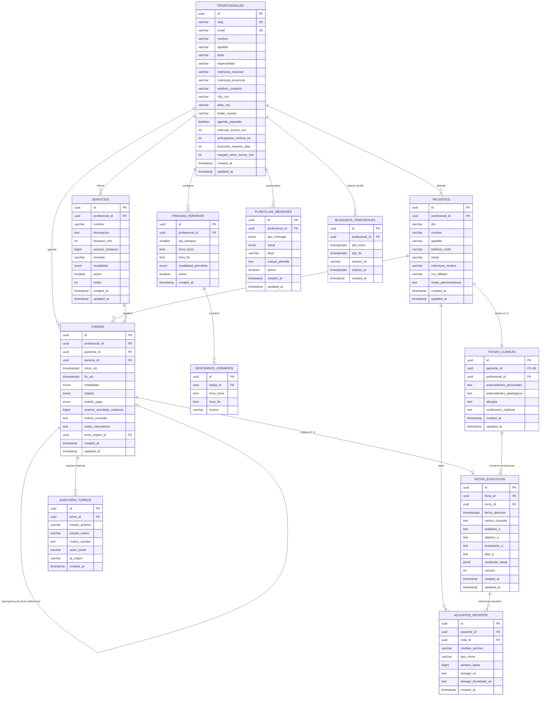

# MediTurnos — Documentación Técnica de Base de Datos Relacional

Este documento contiene la especificación completa del modelo relacional para **PostgreSQL**, el diagrama **Entidad-Relación (ERD)** en sintaxis estándar Mermaid y las instrucciones paso a paso para importarlo y visualizarlo en **MySQL Workbench**, **pgAdmin 4**, **DBeaver** o **Microsoft Visio**.

---

## 1. Diagrama Entidad-Relación (Mermaid ERD)

---

## 2. Diccionario de Datos y Reglas de Negocio

### A. Dominio de Profesionales y Configuración
1. **`profesionales`**:
   - Clave primaria UUID.
   - `slug`: Nombre único para la URL pública del portal (ej: `/lic-martin-benitez`).
   - `intervalo_turnos_min`: Granularidad del turnero (15, 20, 30, 45 o 60 minutos).
   - `anticipacion_minima_hs`: Horas mínimas requeridas para que un paciente tome un turno online (evita turnos inmediatos imprevistos).
   - `horizonte_maximo_dias`: Cuántos días a futuro se abren turnos en el portal (ej: 30 días).

2. **`servicios`**:
   - Define el arancel en centavos (`BIGINT` para evitar errores de coma flotante, ej: `$22.000` = `2200000`).
   - `modalidad`: Enum `'presencial'`, `'videollamada'` o `'ambas'`.
   - `duracion_min`: Duración en minutos que ocupará el turno en la agenda.

3. **`franjas_horarias` y `descansos_horarios`**:
   - `dia_semana`: 1 (Lunes) a 7 (Domingo).
   - Permite que el profesional defina turnos mañana y tarde con un corte para almuerzo.
   - Restricción `CHECK (hora_inicio < hora_fin)`.

### B. Dominio de Pacientes y Agenda
4. **`pacientes`**:
   - Identificación unívoca compuesta: `UNIQUE (profesional_id, dni)`. Permite que un paciente se atienda con varios profesionales sin conflicto de claves.
   - Teléfono almacenado en estándar internacional E.164 (`+54911xxxxxxxx`).

5. **`turnos`**:
   - Almacena horarios en UTC con zona horaria (`TIMESTAMPTZ`), renderizándose en cliente en `America/Argentina/Buenos_Aires`.
   - Estados de ciclo de vida: `'pendiente'`, `'atendido'`, `'ausente'`, `'cancelado'`, `'reprogramado'`.
   - Trazabilidad de reprogramaciones mediante `turno_origen_id`.

6. **`bloqueos_temporales` (Hold)**:
   - Bloqueo transaccional de 10 minutos cuando el paciente hace clic en "Completar mis datos".
   - Si no se completa la reserva, el registro expira y el horario vuelve a liberarse.

### C. Dominio Médico y Documental
7. **`fichas_clinicas` y `notas_evolucion`**:
   - Cada paciente tiene exactamente una ficha clínica (`1:1`).
   - La ficha acumula notas de evolución (`1:N`) redactadas bajo el método **SOAP**:
     - **S**ubjetivo: Lo que relata el paciente.
     - **O**bjetivo: Hallazgos de la exploración médica.
     - **A**preciación / Diagnóstico: Diagnóstico presuntivo o de certeza.
     - **P**lan: Indicaciones, tratamiento farmacológico, ejercicios o pautas de alarma.
   - `contenido_tiptap`: Almacena el árbol JSON enriquecido generado por el editor visual.

8. **`adjuntos_paciente`**:
   - Registra metadatos de archivos de estudios (PDF, JPG, DICOM).
   - `storage_uri`: Ruta o URL del archivo en el sistema de almacenamiento.

---

## 3. Guía de Importación para Generar el Diagrama Visual

### En MySQL Workbench:
1. Abre **MySQL Workbench**.
2. Ve al menú superior: **File** > **New Model**.
3. Selecciona **Database** > **Reverse Engineer...** (o pulsa `Ctrl + R`).
4. Selecciona tu conexión de base de datos o ejecuta el script SQL desde **File** > **Open SQL Script** y abre `docs/schema.sql`.
5. Si deseas generar el diagrama EER directamente desde el script DDL:
   - Ve a **File** > **Import** > **Reverse Engineer MySQL / ANSI Create Script...**
   - Selecciona el archivo `docs/schema.sql`.
   - Marca la casilla *"Place imported objects on a new diagram"*.
   - Haz clic en **Execute** y MySQL Workbench dibujará automáticamente las tablas, columnas, relaciones y claves foráneas en el lienzo gráfico.

### En pgAdmin 4:
1. Abre **pgAdmin 4** y conéctate a tu base de datos PostgreSQL.
2. Abre la **Herramienta de Consulta (Query Tool)** sobre tu base de datos.
3. Carga y ejecuta `docs/schema.sql`.
4. En el panel izquierdo del explorador de objetos, haz clic derecho sobre la base de datos o esquema `public` y selecciona **Generate ERD** (Generar diagrama Entidad-Relación).
5. pgAdmin construirá el diagrama interactivo de todas las tablas y sus relaciones.

### En Microsoft Visio:
1. Abre Microsoft Visio y selecciona la plantilla **Diagrama de Modelo de Base de Datos** (Database Model Diagram).
2. En la pestaña **Base de datos**, haz clic en **Ingeniería inversa** (Reverse Engineer).
3. Selecciona el origen de datos ODBC para PostgreSQL y Visio generará las entidades gráficas y conectores de cardinalidad.

### En herramientas en línea (dbdiagram.io / Eraser):
- El archivo `docs/schema.sql` es compatible con el importador automático de **dbdiagram.io** (menú *"Import from PostgreSQL script"*).
